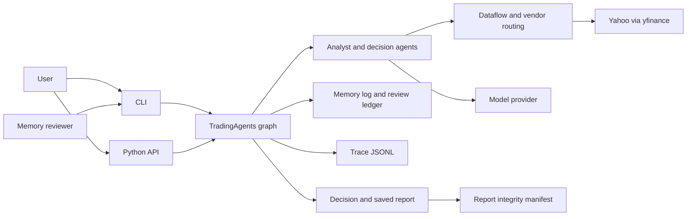

# Project architecture blueprint — draft for review

Revision reviewed: `a60f3507849108dd2de55880c5597db32539fbdf`. This describes the merged application and the team's proposed requirement framing, not a separately approved target architecture.

## System context

The graph is orchestrated in `tradingagents/graph/`; agent code lives in `tradingagents/agents/`; vendor integrations are in `tradingagents/dataflows/`. The diagram is conceptual: actual graph nodes, branches, and failure paths are more detailed.

## Four project increments

1. **Trace:** a `TraceSession` associates one CLI/API attempt with a UUID and records lifecycle and callback-visible model/tool events to a separate JSONL file. Trace write failures warn and do not abort analysis. SDK internal retries, complete vendor fallback, and certain bare-thread calls are not covered.
2. **Memory:** historical decisions and reflections can be bounded by a character budget. Optional human review binds approvals to reflection versions and applies the appropriate analysis-time cutoff.
3. **Market data:** date-range caching and same-key request coalescing sit in the Yahoo dataflow; CSV-cache recovery validates usable data before replacing an existing file. These are process-local coordination mechanisms, not a distributed cache.
4. **Contracts and reporting:** optional enhanced contract modes validate selected agent boundaries and bound recovery. Startup configuration preflight and report integrity manifests also apply. Contract mode defaults to `off`.

## Cross-cutting constraints

- Preserve the difference between live-provider observations and deterministic fixture results.
- Never claim that a successful tool call proves the returned business data is correct.
- Do not claim that a trace or file manifest covers events or security guarantees it cannot observe.
- Respect the as-of-date and review-time cutoffs in historical analysis.
- Treat completed decisions, reports, checkpoints, and trace files as separate artifacts with distinct semantics; Trace IDs do not currently isolate every artifact.
- Changes affecting requirements, tests, or defaults need a review and corresponding evidence. The detailed course specification may add further constraints.

## Verification and evolution

Existing tests and CI are listed in `docs/architecture/team-traceability.md` and `docs/architecture/evaluation-logbook.md`. Architecture decisions and trade-offs are listed in `docs/architecture/adr/003-team-integration-draft.md` and `option-ledger.md`. These records require team confirmation; an unreviewed draft is not a policy already enforced by the tooling.
