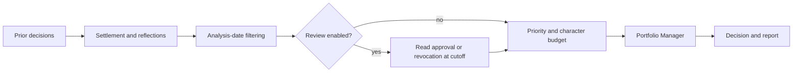

# Memory design — current implementation summary

## Purpose and flow

The Memory log stores decisions, settlement information, and reflections. During a later analysis the system filters eligible historical entries, applies any configured context budget, and supplies selected context to the Portfolio Manager. This document concerns Memory, not checkpoint recovery state or the Yahoo cache.

This is a conceptual view. See the implementation and tests for ordering and error paths.

## Rules and boundaries

- `memory_context_max_chars` bounds the complete returned context when configured; zero produces an empty context. Character count is not a token count. When unset, the old selection behavior applies.
- Same-ticker records have priority; the code tries full and shorter representations under the budget and respects the historical analysis cutoff.
- With `memory_review_enabled` enabled, a human may approve or revoke settled reflections. Approvals bind the ticker, decision date, and reflection version. Live and historical analysis use the applicable cutoff described by the implementation and PR #7.
- Review is disabled by default. Checkpoint resume rechecks the review ledger. A corrupted or unavailable ledger must be handled according to `tests/test_memory_review.py` and the displayed report notice; do not silently describe an unapproved reflection as approved.

## Evidence

PRs #2 and #7; `tradingagents/memory/log.py`, `tradingagents/memory/review.py`, `cli/memory.py`, and `tests/test_memory_log.py`, `tests/test_memory_review.py`, `tests/test_cli_memory_review.py`, `tests/test_graph_end_to_end.py`.
